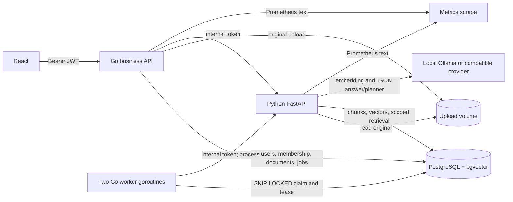

# Architecture: Phase 3

## Implemented

Go owns public HTTP, registration/login, JWT verification, knowledge-base membership, metadata and the durable processing queue. Python owns parsing, chunking, batched embedding, pgvector retrieval, lexical reranking, grounded answer generation and two read-only Agent tools. PostgreSQL holds users, membership, documents, jobs, chunks and the embedding profile. The original file is kept in a shared Docker volume (read-only for Python). Redis, Kafka and a general-purpose Agent are not part of this phase.

## Upload and worker flow

1. An authenticated `admin` or `editor` uploads a supported file, at most 10 MiB. Go saves the file and inserts `documents` plus one unique `processing_jobs` row **in one database transaction**. The API returns HTTP 202 without waiting for model inference.
2. Two Go worker goroutines poll due jobs. A CTE selects one `pending` row with `FOR UPDATE SKIP LOCKED`, increments `attempt_count`, sets a 45-second lease and calls the internal Python process endpoint. A heartbeat extends the lease during long model calls.
3. Python acquires a session advisory lock keyed by document ID. It extracts text, chunks and embeds outside the chunk-writing transaction. It then replaces all chunks and marks the document `ready` in one transaction. `(document_id, chunk_index)` is unique. Replaying a claimed job therefore replaces chunks instead of appending duplicates.
4. A failed attempt becomes `pending` with bounded backoff (2/4/8 seconds); after three attempts the Job becomes `failed`. The document retains a failure reason. At worker restart, expired leases return to `pending` or terminal `failed` based on the attempt count.
5. The Job statuses are `pending`, `processing`, `completed`, `failed`. The pre-existing document terminal success state remains `ready` for compatibility with Phase 1/2 retrieval and reindexing.

The file write and database transaction are separate resources, so a crash between them can leave an orphan file. There is no exactly-once external side effect: this is at-least-once processing with idempotent chunk replacement. See [ASYNC_JOBS.md](docs/ASYNC_JOBS.md).

## Authentication and authorization

Registration hashes passwords with bcrypt; login issues a short-lived HS256 JWT using an untracked random secret. Every public knowledge-base route checks authentication and a membership row. Any authenticated user can create a new isolated knowledge base and becomes its first `admin`. `admin` manages members, deletes knowledge bases/documents and can upload/chat; `editor` can upload/view/chat; `viewer` can view/chat. The Go API checks before forwarding RAG. The Agent's Python tool execution independently checks membership and requested KB/document scope. Internal endpoints require a separate service token. See [RBAC.md](docs/RBAC.md).

## Query and Agent flow

Ordinary RAG still uses the Phase 2 pipeline: query embedding → pgvector cosine Top-8 **filtered by knowledge base in SQL** → lexical rerank Top-4 → bounded context → answer provider → server-built citations from selected rows. Citation IDs and names never come from LLM text. Only `ready` documents participate. The 20+4 public fixture and reindex profile guard remain unchanged.

The Agent endpoint accepts a question under one authorized KB. A JSON planner using the configured model chooses one of `search_knowledge_base`, `get_document_metadata`, or `finish`. The two tools are read-only, have strict schemas and repeat permission checks. Results become untrusted context for the answer provider; the final citation is built from an actual chunk or document metadata row. One tool execution is currently the hard upper bound within a three-iteration guard; this is **JSON planning**, not native Ollama function calling. Arbitrary URLs, shell and generated SQL cannot be executed. See [AGENT_DESIGN.md](docs/AGENT_DESIGN.md) and [SECURITY.md](docs/SECURITY.md).

## Actually validated

The local Compose stack, real pgvector, two concurrent worker claims, bounded retries, actual backend restart recovery, RBAC denial paths, real local-model Agent calls, and the unchanged 20+4 RAG fixture were run in Phase 3. Raw Agent and RAG results are in `docs/evaluation/results/phase3_*`. Exact commands and limitations are in [PHASE3_VALIDATION.md](docs/PHASE3_VALIDATION.md).

## Not validated and known limits

There is no email verification, login rate limit, JWT revocation list, multiple host deployment, HA database, OCR, learned reranker, independent security audit, concurrent model capacity test, or cloud-model validation. The current JSON planner may abstain or choose an unsuitable tool. `RAG_DEBUG=1` returns context text to authorized users and must be disabled for less trusted environments. Metrics use small in-process counters and durations, without persistent metrics storage or a Grafana dashboard.
