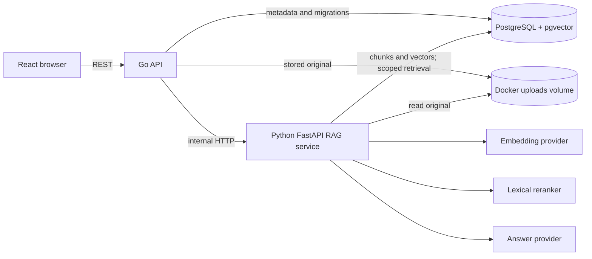

# Architecture: Phases 1 and 2

## Scope

The system provides a document-to-answer RAG loop and Phase 2 evaluation. It has no users, RBAC, background jobs, Redis, agent tools, monitoring, or production rate limits. The default model providers remain deterministic development implementations, not neural embeddings or an LLM. Optional real OpenAI-compatible providers require a user key and have not been live-verified.

## Responsibilities

- **Go API:** public knowledge base and document endpoints, upload validation, metadata persistence, forwarding RAG requests, migration on startup. SQL parameters prevent injection. The default CORS origin is the local frontend.
- **Python AI service:** file parsing, whitespace cleaning, paragraph-aware chunks with overlap, batched embeddings, pgvector search, reranking, context assembly, answer generation and server-built citations. OpenAI-compatible calls use bounded timeout/retry logic behind provider interfaces. Only Docker-internal endpoints are exposed.
- **PostgreSQL/pgvector:** durable metadata and vector rows. Versioned SQL migrations create the extension, tables and a singleton embedding profile. Each chunk has its parent document, ordered index, content, JSON metadata and currently a 1536-dimensional vector. Ingestion/query reject a different model space or dimension until explicit reindex.
- **Docker volume:** retains original uploads so processing survives request completion. The Go and Python containers use a shared UID/GID (10001); Go writes files as `0640`, and Python mounts the volume read-only. The local host API port is 18080 to coexist with another project.
- **React:** small UI for creating/selecting knowledge bases, uploading documents, seeing status, asking questions and seeing citations.

## Ingestion flow

1. Go validates a 10 MiB maximum upload and a supported extension, writes it to a generated path, inserts a `pending` document row.
2. Go calls the Python service synchronously. Python changes status to `processing`, reads the saved file, extracts text, chunks and embeds it.
3. A database transaction replaces this document's chunks and sets `ready` plus count. A processing exception records `failed` plus a bounded reason.
4. Synchronous processing is intentionally simple for Phase 1. A long model call occupies a request; background jobs and retries belong to a later phase.

## Query flow

1. Go validates the knowledge base and question.
2. Python embeds the question, executes a parameterized pgvector cosine-distance search, joining through `documents` and filtering by the requested knowledge base and `ready` status.
3. The top 8 vector results are recorded, lexically reranked, and the best 4 become context.
4. The answer provider returns text plus indices into that context. Python validates indices and constructs citations from the actual database rows, never from model-provided document names or IDs.

In local debug mode the response also includes query, candidate contents and scores, before/after rerank order, final context, character/token estimates and stage latencies. Ordinary server logs include only IDs, lengths and timing, not full uploaded text or credentials. The versioned 20-positive/4-unsupported corpus and runner measure retrieval/citation/refusal behavior in a temporary knowledge base; see [RAG_EVALUATION.md](docs/RAG_EVALUATION.md).

## Data integrity and limitations

The migration uses foreign keys and unique (document_id, chunk_index) to keep chunks tied to one document. One processing transaction writes all chunks and the final status. Upload file creation and the initial document insert are not one atomic operation, so a process crash can leave an orphan file or pending row. There is no authentication yet. The development hash vectors support repeatable tests but do not provide semantic understanding. The OpenAI-compatible providers are optional and need a user-supplied key and separate real-model verification. A model or dimension switch uses the staged maintenance workflow in [REINDEX.md](docs/REINDEX.md).
