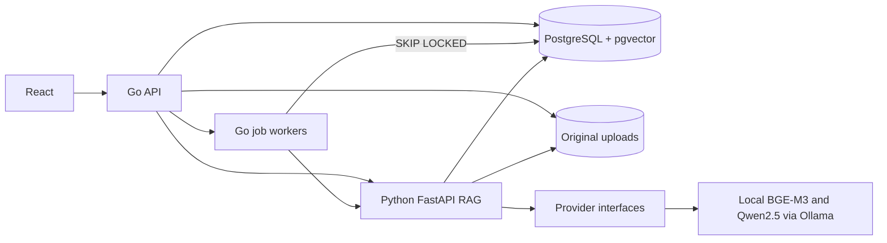

# Enterprise AI Knowledge Platform

An enterprise knowledge base **prototype** with a Go business API, Python RAG service, React UI, PostgreSQL/pgvector and locally verified real models. It supports durable asynchronous ingestion, knowledge-base RBAC and two read-only Agent tools. It is not a production multi-tenant service.

## At a glance

The implemented path is: PDF/DOCX/TXT/Markdown upload → saved file and PostgreSQL Job → two Go workers → Python parse/chunk/batch-embed → pgvector; authenticated question → scoped vector Top-8 → lexical rerank Top-4 → Qwen answer → server-owned database citations. The Agent path first asks Qwen for a JSON plan, validates the chosen read-only tool and its arguments, rechecks membership, then generates a grounded answer. This is JSON planning, not native function calling.

## Phase 1 features

- Create, list and inspect knowledge bases.
- Upload PDF, DOCX, TXT and Markdown files (10 MiB maximum); store originals and document processing status.
- Extract text, create paragraph-aware overlapping chunks, persist vectors and metadata. The default development schema is 1536 dimensions; the tested local BGE-M3 profile uses 1024.
- Search within one knowledge base using pgvector cosine distance, rerank a Top-8 candidate set to 4 chunks, and return an answer with database-backed citations.
- Browse authorized knowledge bases, document status and cited answers in a basic React UI.

**Model modes:** The default `hash` embedding and `extractive` answerer are deterministic **test providers**, not neural models. The opt-in local profile runs real BGE-M3 and Qwen2.5 models through the same OpenAI-compatible interfaces and has been tested on this workstation. Cloud model calls still require your own API key and have **not** been verified. The UI is intentionally minimal; use the result's `answer_mode`/`planner_mode` and deployment configuration to identify the active mode.

## Phase 2 engineering

- OpenAI-compatible Embedding and Chat Completion adapters behind provider interfaces, selectable by environment variables. They have batch embedding, dimension/response validation, bounded timeout/retry and safe error text. Local Ollama calls are verified; paid cloud calls are not.
- PostgreSQL embedding identity guard and a tested staged rebuild/rollback procedure for a changed model or vector dimension. See [REINDEX.md](docs/REINDEX.md).
- A public synthetic corpus with 20 source-backed questions and four unsupported questions. The runner reports retrieval and citation/refusal metrics; [RAG_EVALUATION.md](docs/RAG_EVALUATION.md) records the actual development-mode before/after.
- Local RAG debug responses show retrieval scores, rerank order, final context and stage latency. Disable RAG_DEBUG outside a trusted development environment.

## Phase 2.5 local real-model acceptance

On an RTX 4080 with Docker GPU passthrough, Ollama ran `bge-m3:567m-fp16` (real 1024-dimensional embeddings) and `qwen2.5:7b-instruct-q4_K_M` (real generated answers). The 20 source-backed / 4 unsupported-question final run measured **Hit@8=1.00, Recall@8=1.00, MRR=1.00**, 21/21 database-valid in-scope citations and 4/4 unsupported refusals. This small synthetic set does not establish general semantic quality. In a separate assistant case-by-case review of ten answers, all ten had at least one supporting citation, but one answer also carried an irrelevant extra citation. See [raw results and limitations](docs/RAG_EVALUATION.md) and [the review](docs/evaluation/MANUAL_REVIEW_LOCAL.md).

The final warm single-request RAG median/P95 was **371.25/483.56 ms** on this workstation. First model load and concurrent capacity are outside that figure; a cold Qwen smoke call took 28.5 seconds. No cloud-model result or production performance claim is made.

## Phase 3 engineering

- Upload returns HTTP 202 after one transaction creates the document and a durable PostgreSQL Job. Two Go workers claim due jobs with `FOR UPDATE SKIP LOCKED`, heartbeat a lease, retry up to three times and recover expired leases after restart. Python serializes same-document processing and replaces chunks transactionally. The existing document success state is `ready`; Job success is `completed`.
- Registration/login use bcrypt and a 2-hour HS256 JWT. Knowledge-base `admin`, `editor` and `viewer` permissions are enforced by Go on every public knowledge-base endpoint. An authenticated user can create a new isolated knowledge base and becomes its admin. Python Agent tools recheck membership and document scope.
- `POST /knowledge-bases/{id}/agent` uses a JSON planner with only `search_knowledge_base` and `get_document_metadata`; tool arguments and permissions are checked in code. This local-model path is **JSON planning, not native function calling**. Citations come from actual chunk or document rows.
- Go and Python expose basic Prometheus text metrics. The real Phase 3 local-model rerun of the unchanged 20+4 fixture again measured Hit@8/Recall@8/MRR **1.00/1.00/1.00**, 20/20 database-valid in-scope citations, 20/20 expected-document citations and 4/4 unsupported refusals. This is a narrow synthetic fixture, not a general quality claim. [Raw RAG results](docs/evaluation/results/phase3_rag_real.json), [12 Agent cases before](docs/evaluation/results/phase3_agent_local_real_before.json), [after](docs/evaluation/results/phase3_agent_local_real_after.json), [strict citation recheck](docs/evaluation/results/phase3_agent_local_real_verified.json) and [validation notes](docs/PHASE3_VALIDATION.md) are retained.

## Phase 4 local performance and quality check

On this Windows Docker Desktop workstation with an RTX 4080, the fixed local BGE-M3/Qwen model pair was warmed and then called **sequentially**: 30 ordinary RAG requests cycling the unchanged 20+4 public cases, and 20 successful Agent requests cycling four fixed questions. Top-8, rerank-4, 3200 context characters and model sampling settings were held constant throughout this run. These are single-request timings, **not concurrent throughput**. Millisecond percentiles use linear interpolation of observed samples; [raw per-request result](docs/evaluation/results/phase4_latency.json) and [14 host telemetry samples](docs/evaluation/results/phase4_host_samples.csv) are retained.

| Stage | RAG median / P95 / P99 (30) | Agent median / P95 / P99 (20) |
| --- | ---: | ---: |
| Embedding | 12.06 / 34.96 / 45.47 ms | 12.02 / 19.45 / 21.91 ms* |
| Database retrieval | 9.89 / 11.93 / 14.22 ms | 1.78 / 2.30 / 2.33 ms* |
| Lexical rerank | 0.17 / 0.44 / 0.64 ms | 0.17 / 0.26 / 0.60 ms* |
| LLM answer generation | 422.96 / 535.34 / 566.69 ms | 316.85 / 388.78 / 399.04 ms |
| Total service request | **448.14 / 557.73 / 593.43 ms** | **987.85 / 1096.51 / 1098.29 ms** |

*Agent metadata calls do not embed or retrieve vectors; zeros for those cases are included in the 20-case distribution. Agent total includes the JSON planner call, which is not included in its answer-generation row. Host GPU samples ranged **9–93%** utilization and **2342–8080 MiB** used VRAM; host CPU samples ranged **17.40–61.66%**. These are whole-host/GPU readings, not Ollama process attribution. The 30 RAG calls reported 1148 completion tokens over 13.08 s summed generation-stage wall time, about **87.74 tokens per stage-wall second**, including request overhead rather than pure decoding.

The older Phase 2.5 RAG median/P95 was 371.25/483.56 ms; Phase 3 recorded 948.05/1396.82 ms under a busier, unattributed GPU state. Phase 4 was closer to Phase 2.5, supporting environment/model-runtime variability as a plausible contributor, **not proving a causal performance fix**. Phase 4 also contains a small general prompt clarification to preserve numeric units; these historical runs are not a strict identical-prompt benchmark. The unchanged 20+4 evaluation after that change retained Hit@8/Recall@8/MRR 1.00 and 4/4 refusals. See [FINAL_VALIDATION.md](docs/FINAL_VALIDATION.md) for quality caveats and test conditions.

## Run locally

For a fresh development-mode database, install Docker Desktop with a running Engine. Copy `.env.example` to an untracked `.env`, set a local database password and matching `DATABASE_URL`, and generate independent random values of at least 32 bytes for `JWT_SECRET` and `INTERNAL_SERVICE_TOKEN`. From this repository root:

```sh
docker compose --env-file .env -f deployments/compose.yaml up --build
```

Open `http://localhost:5173`, register, create a knowledge base, upload a document and wait for `ready`. The Go API listens at host `http://localhost:18080` (container port 8080), PostgreSQL is mapped to host port `55432`, and the Python service is internal to Compose. Host ports bind to `127.0.0.1` for local development. Check containers with the same Compose arguments plus `ps`. Default Compose database credentials are **local development only**; an existing volume keeps its old password, so match the `.env` to that volume or start a fresh one deliberately.

For the **local GPU model**, follow [LOCAL_MODELS.md](docs/LOCAL_MODELS.md). The current acceptance database on this workstation has the BGE-M3 `vector(1024)` profile, so it must be started with both `deployments/compose.yaml` and `deployments/compose.local-model.yaml`. Switching between model spaces requires the documented maintenance workflow; changing only environment variables is blocked. For a cloud OpenAI-compatible endpoint, set provider names, endpoint, model names, dimensions and a real key in an untracked `.env`, then perform a separate model-specific validation. Cloud cost and output quality have not been measured.

API clients first call `POST /auth/register` and `POST /auth/login`, then send `Authorization: Bearer <access_token>` to all knowledge-base routes. Upload returns 202; poll `GET /knowledge-bases/{id}/documents` until `ready` or `failed`. Admins use `PUT /knowledge-bases/{id}/members/{userID}` with `{"role":"editor"}` or `{"role":"viewer"}`. Chat and Agent endpoints are both scoped to the selected knowledge base. See [RBAC.md](docs/RBAC.md) and [AGENT_DESIGN.md](docs/AGENT_DESIGN.md).

## Architecture



The Go API owns authentication, RBAC, metadata, the Job queue and public routes. Python parses saved documents, builds chunks/vectors, performs filtered retrieval and creates citations from actual database rows. See [ARCHITECTURE.md](ARCHITECTURE.md) and [RAG design](docs/RAG_DESIGN.md).

### Async Job and RBAC

Upload commits one `documents` row and one `processing_jobs` row, then returns 202. Two workers claim due jobs with `FOR UPDATE SKIP LOCKED`, heartbeat a lease, retry at most three times and recover expired leases. Python serializes processing of the same document and transactionally replaces its chunks. A completed Job leaves the document `ready`. This is at-least-once work with idempotent stored state; see [ASYNC_JOBS.md](docs/ASYNC_JOBS.md).

`admin` creates and manages a knowledge base, documents and members; `editor` uploads and reads; `viewer` reads and asks. An authenticated user may create a new KB and becomes its admin. Go checks every public KB route; Agent tools independently check membership and document scope. See [RBAC.md](docs/RBAC.md).

### Local models and safety boundary

The tested local embedding model is **`bge-m3:567m-fp16`** (1024 dimensions), and the tested LLM is **`qwen2.5:7b-instruct-q4_K_M`**, served by Ollama's OpenAI-compatible interface on an RTX 4080. The deterministic hash/extractive providers remain test fixtures. Cloud providers are configurable but **have not been run or benchmarked** here. Model switching requires the [staged reindex procedure](docs/REINDEX.md).

Retrieved documents are lower-trust data. The Agent can call only `search_knowledge_base` or `get_document_metadata`; schemas, KB scope and permissions are checked in code. The model cannot invoke shell, arbitrary URL or generated SQL tools. Eight invalid plans and several live isolation/injection cases were tested; see [SECURITY.md](docs/SECURITY.md). This is bounded test coverage, not a general prompt-injection guarantee.

## Tests

The test commands and their **actual outcomes** are recorded in [docs/TEST_RESULTS.md](docs/TEST_RESULTS.md). Python integration/evaluation tests need a real PostgreSQL/pgvector database; missing TEST_DATABASE_URL is an error rather than a silent skip. The hash test database and 1024-dimensional local-real database are separate. The public synthetic corpus and both modes' raw results are committed, clearly named by provider.

For the local-model stack, run `docker compose --env-file .env -f deployments/compose.yaml -f deployments/compose.local-model.yaml up -d --build`, then check health with the same arguments plus `ps`. To try the demo, register in the UI, create a KB, upload one of the supported files, wait until its state is `ready`, ask a question, inspect the returned citation and try the separate Agent action. To run tests, use `python -m pytest -q tests` from `ai-service/` with the documented real test DB variables, `go test -count=1 ./...`, `go vet ./...`, `go test -race -count=1 ./...` from `backend/`, and `npm run build` from `frontend/`. Exact final commands and conditions are in [FINAL_VALIDATION.md](docs/FINAL_VALIDATION.md).

## Repository map

`frontend/` holds the React UI; `backend/` contains the Go API, auth, queue and migrations; `ai-service/` contains parsing, RAG, providers, Agent and Python tests; `deployments/` has Compose; `docs/` keeps design notes, raw public evaluation results, security boundaries, [learning notes](docs/LEARNING.md) and [32 project interview questions](docs/INTERVIEW.md).

## Known limits

- Self-registration has no email verification or login rate limit; JWTs expire after two hours and have no explicit revocation list. Use only behind trusted local ingress until those controls are added.
- A crash between the upload-volume file write and the database transaction may leave an orphan file. The PostgreSQL queue is single-database and has no multi-host HA claim.
- The Agent currently executes at most one read-only tool per question. Its JSON planner is not native function calling; the no-tool greeting case abstained in the real-model test. A model can still make a wrong tool choice or unsupported claim.
- Basic metrics are scrape endpoints, without a Prometheus server, alerting or Grafana dashboard in this phase.
- Exact pgvector search is suitable for small data sets; ANN index, recall and latency need measurement before a larger deployment.
- PDF extraction does not perform OCR. Document table/layout and citations may be imperfect.
- Lexical reranking may reorder a genuine semantic hit poorly on other corpora; this small set had no measured retrieval misses.
- A genuine citation proves provenance, not answer faithfulness or the relevance of every returned chunk. The local manual review found one extra, non-supporting chunk among its ten reviewed answers.
- The 20+4 synthetic corpus is narrow. Local real-model calls and single-request latency were measured; cloud model calls, broader semantic quality, concurrent capacity and deployment cost remain unverified.
