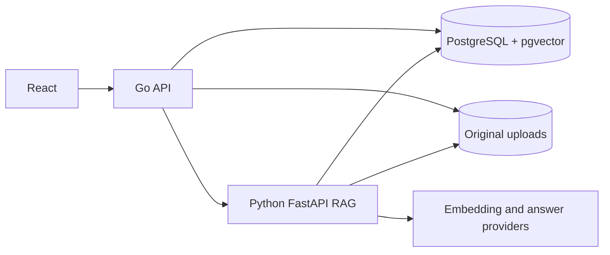

# Enterprise AI Knowledge Platform

A Phase 1–2.5 enterprise knowledge base prototype with a Go business API, Python RAG service, React UI, PostgreSQL and pgvector. It makes the document-to-answer path inspectable and provides separate development, local real-model and cloud-provider modes. It is not a production multi-tenant system.

## Phase 1 features

- Create, list and inspect knowledge bases.
- Upload PDF, DOCX, TXT and Markdown files (10 MiB maximum); store originals and document processing status.
- Extract text, create paragraph-aware overlapping chunks, persist vectors and metadata. The default development schema is 1536 dimensions; the tested local BGE-M3 profile uses 1024.
- Search within one knowledge base using pgvector cosine distance, rerank a Top-8 candidate set to 4 chunks, and return an answer with database-backed citations.
- Browse knowledge bases, document status and cited answers in a basic React UI.

**Model modes:** The default `hash` embedding and `extractive` answerer are deterministic **test providers**, not neural models. The opt-in local profile runs real BGE-M3 and Qwen2.5 models through the same OpenAI-compatible interfaces and has been tested on this workstation. Cloud model calls still require your own API key and have **not** been verified. The UI remains a minimal Phase 1 interface; use the result's `answer_mode` and deployment configuration to identify the active mode.

## Phase 2 engineering

- OpenAI-compatible Embedding and Chat Completion adapters behind provider interfaces, selectable by environment variables. They have batch embedding, dimension/response validation, bounded timeout/retry and safe error text. Local Ollama calls are verified; paid cloud calls are not.
- PostgreSQL embedding identity guard and a tested staged rebuild/rollback procedure for a changed model or vector dimension. See [REINDEX.md](docs/REINDEX.md).
- A public synthetic corpus with 20 source-backed questions and four unsupported questions. The runner reports retrieval and citation/refusal metrics; [RAG_EVALUATION.md](docs/RAG_EVALUATION.md) records the actual development-mode before/after.
- Local RAG debug responses show retrieval scores, rerank order, final context and stage latency. Disable RAG_DEBUG outside a trusted development environment.

## Phase 2.5 local real-model acceptance

On an RTX 4080 with Docker GPU passthrough, Ollama ran `bge-m3:567m-fp16` (real 1024-dimensional embeddings) and `qwen2.5:7b-instruct-q4_K_M` (real generated answers). The 20 source-backed / 4 unsupported-question final run measured **Hit@8=1.00, Recall@8=1.00, MRR=1.00**, 21/21 database-valid in-scope citations and 4/4 unsupported refusals. This small synthetic set does not establish general semantic quality. In a separate assistant case-by-case review of ten answers, all ten had at least one supporting citation, but one answer also carried an irrelevant extra citation. See [raw results and limitations](docs/RAG_EVALUATION.md) and [the review](docs/evaluation/MANUAL_REVIEW_LOCAL.md).

The final warm single-request RAG median/P95 was **371.25/483.56 ms** on this workstation. First model load and concurrent capacity are outside that figure; a cold Qwen smoke call took 28.5 seconds. No cloud-model result or production performance claim is made.

## Run locally

For a fresh development-mode database, install Docker Desktop with a running Engine, then from this repository root:

```sh
docker compose -f deployments/compose.yaml up --build
```

Open `http://localhost:5173`. The Go API listens at host `http://localhost:18080` (container port 8080), PostgreSQL is mapped to host port `55432`, and the Python service is internal to Compose. Host ports bind to `127.0.0.1` for local development; the API port avoids clashing with an existing local project. Check containers with `docker compose -f deployments/compose.yaml ps`. Default Compose credentials are **local development only**. For a shared environment, copy `.env.example` to `.env`, choose a strong `POSTGRES_PASSWORD`, update `DATABASE_URL` to match, and keep `.env` private.

For the **local GPU model**, follow [LOCAL_MODELS.md](docs/LOCAL_MODELS.md). The current acceptance database on this workstation has the BGE-M3 `vector(1024)` profile, so it must be started with both `deployments/compose.yaml` and `deployments/compose.local-model.yaml`. Switching between model spaces requires the documented maintenance workflow; changing only environment variables is blocked. For a cloud OpenAI-compatible endpoint, set provider names, endpoint, model names, dimensions and a real key in an untracked `.env`, then perform a separate model-specific validation. Cloud cost and output quality have not been measured.

Example API calls:

```sh
curl -X POST http://localhost:18080/knowledge-bases -H "Content-Type: application/json" -d '{"name":"Company handbook"}'
curl -F "file=@handbook.txt" http://localhost:18080/knowledge-bases/KNOWLEDGE_BASE_ID/documents
curl -X POST http://localhost:18080/knowledge-bases/KNOWLEDGE_BASE_ID/chat -H "Content-Type: application/json" -d '{"question":"What is the leave policy?"}'
```

## Architecture



The Go API owns knowledge base/document metadata, validation and public HTTP routes. The Python service parses saved documents, builds chunks/vectors, performs filtered vector retrieval and creates citations from actual retrieved database rows. See [ARCHITECTURE.md](ARCHITECTURE.md) and [RAG design](docs/RAG_DESIGN.md).

## Tests

The test commands and their **actual outcomes** are recorded in [docs/TEST_RESULTS.md](docs/TEST_RESULTS.md). Python integration/evaluation tests need a real PostgreSQL/pgvector database; missing TEST_DATABASE_URL is an error rather than a silent skip. The hash test database and 1024-dimensional local-real database are separate. The public synthetic corpus and both modes' raw results are committed, clearly named by provider.

## Known limits

- No login, RBAC, tenant security, asynchronous task queue, Redis, agent tools, metrics or production deployment controls.
- Ingestion is synchronous and a crash may leave a `pending` row or orphan original file. No automatic retry worker exists.
- Exact pgvector search is suitable for small data sets; ANN index, recall and latency need measurement before a larger deployment.
- PDF extraction does not perform OCR. Document table/layout and citations may be imperfect.
- Lexical reranking may reorder a genuine semantic hit poorly on other corpora; this small set had no measured retrieval misses.
- A genuine citation proves provenance, not answer faithfulness or the relevance of every returned chunk. The local manual review found one extra, non-supporting chunk among its ten reviewed answers.
- The 20+4 synthetic corpus is narrow. Local real-model calls and single-request latency were measured; cloud model calls, broader semantic quality, concurrent capacity and deployment cost remain unverified.
