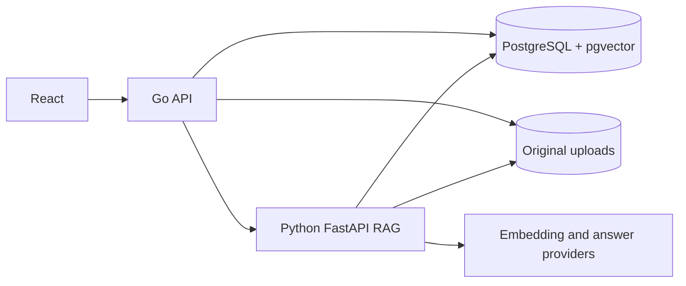

# Enterprise AI Knowledge Platform

A Phase 1/2 enterprise knowledge base prototype with a Go business API, Python RAG service, React UI, PostgreSQL and pgvector. It makes the document-to-answer path inspectable and adds provider boundaries plus a repeatable evaluation corpus. It is not a production multi-tenant system.

## Phase 1 features

- Create, list and inspect knowledge bases.
- Upload PDF, DOCX, TXT and Markdown files (10 MiB maximum); store originals and document processing status.
- Extract text, create paragraph-aware overlapping chunks, persist 1536-dimensional vectors and metadata.
- Search within one knowledge base using pgvector cosine distance, rerank a Top-8 candidate set to 4 chunks, and return an answer with database-backed citations.
- Browse knowledge bases, document status and cited answers in a basic React UI.

**Model honesty:** The default `hash` embedding is a deterministic lexical test implementation, and `extractive` answers copy a relevant sentence. Neither is a real semantic model or LLM. Optional OpenAI-compatible providers are wired behind interfaces, but require your own API key and separate end-to-end verification. The UI identifies its development mode.

## Phase 2 engineering

- Real OpenAI-compatible Embedding and Chat Completion adapters behind provider interfaces, selectable by environment variables. They have batch embedding, dimension/response validation, bounded timeout/retry and safe error text. **Live paid-model calls have not been verified without a user key.**
- PostgreSQL embedding identity guard and a tested staged rebuild/rollback procedure for a changed model or vector dimension. See [REINDEX.md](docs/REINDEX.md).
- A public synthetic corpus with 20 source-backed questions and four unsupported questions. The runner reports retrieval and citation/refusal metrics; [RAG_EVALUATION.md](docs/RAG_EVALUATION.md) records the actual development-mode before/after.
- Local RAG debug responses show retrieval scores, rerank order, final context and stage latency. Disable RAG_DEBUG outside a trusted development environment.

## Run locally

Install Docker Desktop with a running Engine, then from this repository root:

```sh
docker compose -f deployments/compose.yaml up --build
```

Open `http://localhost:5173`. The Go API listens at host `http://localhost:18080` (container port 8080), PostgreSQL is mapped to host port `55432`, and the Python service is internal to Compose. Host ports bind to `127.0.0.1` for local development; the API port avoids clashing with an existing local project. Check containers with `docker compose -f deployments/compose.yaml ps`. Default Compose credentials are **local development only**. For a shared environment, copy `.env.example` to `.env`, choose a strong `POSTGRES_PASSWORD`, update `DATABASE_URL` to match, and keep `.env` private.

The app starts in test/development model mode. To try real OpenAI-compatible APIs, set EMBEDDING_PROVIDER=openai, ANSWER_PROVIDER=openai, OPENAI_API_KEY, model names and EMBEDDING_DIMENSIONS in an untracked .env. The current column is vector(1536). If vectors already exist from another model, follow [REINDEX.md](docs/REINDEX.md); changing only the environment variables is blocked. API cost and output quality have not been measured.

Example API calls:

```sh
curl -X POST http://localhost:18080/knowledge-bases -H "Content-Type: application/json" -d '{"name":"Company handbook"}'
curl -F "file=@handbook.txt" http://localhost:18080/knowledge-bases/KNOWLEDGE_BASE_ID/documents
curl -X POST http://localhost:18080/knowledge-bases/KNOWLEDGE_BASE_ID/chat -H "Content-Type: application/json" -d '{"question":"What is the leave policy?"}'
```

## Architecture



The Go API owns knowledge base/document metadata, validation and public HTTP routes. The Python service parses saved documents, builds chunks/vectors, performs filtered vector retrieval and creates citations from actual retrieved database rows. See [ARCHITECTURE.md](ARCHITECTURE.md) and [RAG design](docs/RAG_DESIGN.md).

## Tests

The test commands and their **actual outcomes** are recorded in [docs/TEST_RESULTS.md](docs/TEST_RESULTS.md). The Python integration/evaluation tests need running Compose PostgreSQL and migrations; missing TEST_DATABASE_URL is an error rather than a silent skip. The development-provider evaluation inputs and raw results are committed because the corpus is synthetic. A real-model run must be named and reported separately.

## Known limits

- No login, RBAC, tenant security, asynchronous task queue, Redis, agent tools, metrics or production deployment controls.
- Ingestion is synchronous and a crash may leave a `pending` row or orphan original file. No automatic retry worker exists.
- Exact pgvector search is suitable for small data sets; ANN index, recall and latency need measurement before a larger deployment.
- PDF extraction does not perform OCR. Document table/layout and citations may be imperfect.
- Hash vectors and lexical reranking do not establish semantic retrieval quality. A genuine citation proves provenance, not answer faithfulness.
- The small synthetic evaluation set does not measure real-model semantic quality. Real model calls, latency and cost remain unverified until a key is supplied and the tests actually run.
- No performance or model-quality benchmark is claimed for this phase.
